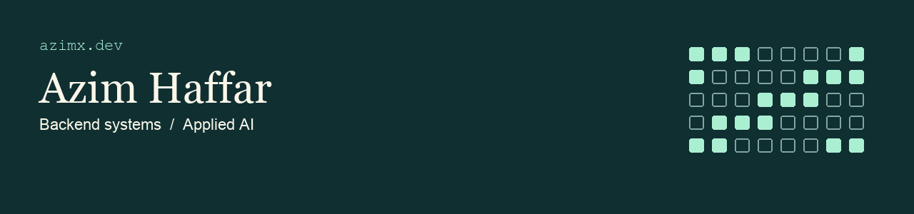

I’m a Software Engineering student at OSTİM Technical University working on applied AI and backend systems. I built and demonstrated a Spring Boot coupon tracker at Trendyol and delivered a paid Python/LLM study tool with separate evaluation and validation at Kvote.

[Portfolio](https://www.azimx.dev/) · [LinkedIn](https://www.linkedin.com/in/azim-haffar/)  
**Seeking paid 2027 internships · Hamburg first · Available 17 January–20 August 2027**

## Start here — public code

| Project | What I built | Explore |
| --- | --- | --- |
| **[ML Training Inspector](https://github.com/azim-haffar/ml-training-inspector)** | PyTorch training dashboard with reproducible synthetic CPU training and comparison of saved run settings and epoch metrics. **PyTorch · FastAPI · React** | [60-second tour](https://github.com/azim-haffar/ml-training-inspector#60-second-project-tour--no-setup-required) · [CPU demo](https://github.com/azim-haffar/ml-training-inspector#quick-reproducible-cpu-demo) · [Engineering notes](https://github.com/azim-haffar/ml-training-inspector/blob/main/ENGINEERING_NOTES.md) |
| **[HireLens](https://github.com/azim-haffar/HireLens)** | CV-to-job analysis combining LLM extraction with explainable, rule-based matching. **Python · FastAPI · React · Supabase** | [60-second tour](https://github.com/azim-haffar/HireLens#60-second-project-tour--no-account-required) · [Scoring code](https://github.com/azim-haffar/HireLens/blob/main/backend/app/services/match_scorer.py) · [Offline advice review](https://github.com/azim-haffar/HireLens/blob/main/docs/advice-evaluation.md) · [Tests](https://github.com/azim-haffar/HireLens/tree/main/backend/tests) |
| **[OrderFlow](https://github.com/azim-haffar/OrderFlow)** | Event-driven order processing with a transactional outbox, duplicate handling and documented Kafka failure recovery. **Java · Spring Boot · Kafka · PostgreSQL · Redis** | [60-second tour](https://github.com/azim-haffar/OrderFlow#60-second-project-tour--no-setup-required) · [Architecture](https://github.com/azim-haffar/OrderFlow/blob/main/docs/architecture.md) · [Failure & recovery](https://github.com/azim-haffar/OrderFlow/blob/main/docs/failure-recovery.md) |
| **[azimx.dev](https://github.com/azim-haffar/azimx.dev)** | Engineering portfolio with project decisions, visual explanations and evidence boundaries. **Next.js · React · TypeScript** | [Website](https://www.azimx.dev/) |

## More projects

| Project | Focus | View |
| --- | --- | --- |
| **Skina** | Fictional retail advisor: deterministic basket selection with separately gated AI explanations. **React · TypeScript · Node.js** | [Case study & screenshot](https://www.azimx.dev/projects/skina) · Local prototype; mocked shopper explanations; source private. |
| **MotionTrace** | Research workbench comparing classical and learned target tracking. **Python · Applied ML** | [Research case study](https://www.azimx.dev/projects/motiontrace) · Negative result retained; no clinical validation; research assets withheld. |
| **SeatLedger** | Capacity-limited reservations, concurrent requests and replayable analytics. **Spring Boot · PostgreSQL · React · TypeScript** | [Case study](https://www.azimx.dev/projects/seatledger) · Source private; hosted API availability unverified. |

Toolkit, education & project scope

**Backend & data:** Java, Python, SQL, Spring Boot, FastAPI, PostgreSQL, Kafka, Redis, Docker.  
**AI & interfaces:** LLM APIs, PyTorch, React, JavaScript, TypeScript.  
**Quality:** JUnit, Testcontainers, Playwright, GitHub Actions.

B.Sc. Software Engineering, **OSTİM Technical University** · Expected August 2027.  
English C1 · German B1 · Turkish and Arabic native.

These are portfolio projects with documented limits. HireLens scores are heuristics, not hiring predictions; live authentication and provider quality remain unverified. ML Training Inspector uses a synthetic CPU demo and does not implement training resume. OrderFlow is a local project with at-least-once delivery and one outbox publisher. SeatLedger uses synthetic data, may cold-start slowly and has email disabled. Its [hosted preview](https://seatledger.azimx.dev/) loaded on 11 November 2026, but the API did not respond during that check; use the case study for a review without backend access. Repositories contain setup instructions and evidence boundaries; no production usage or model-quality claim is implied.

